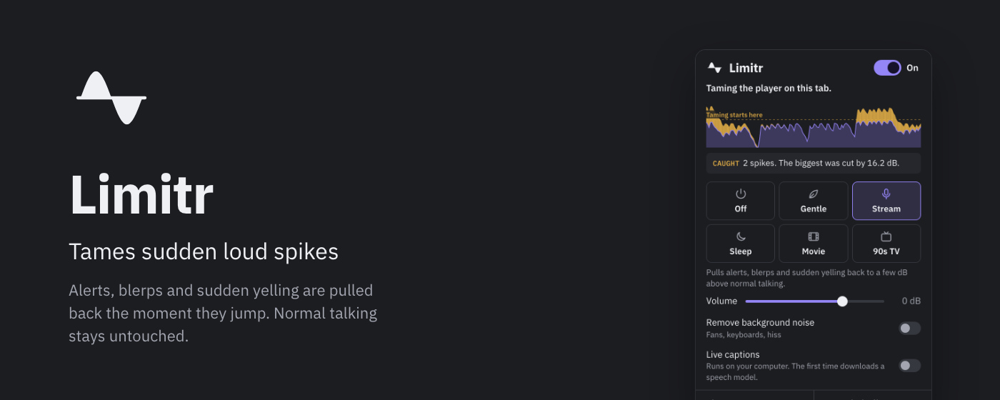
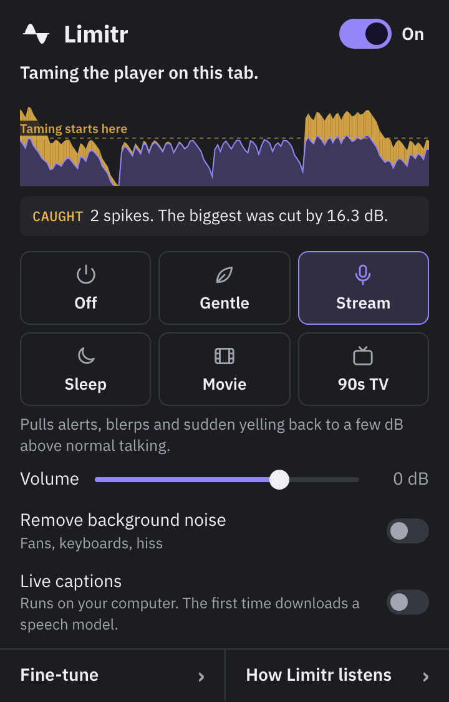
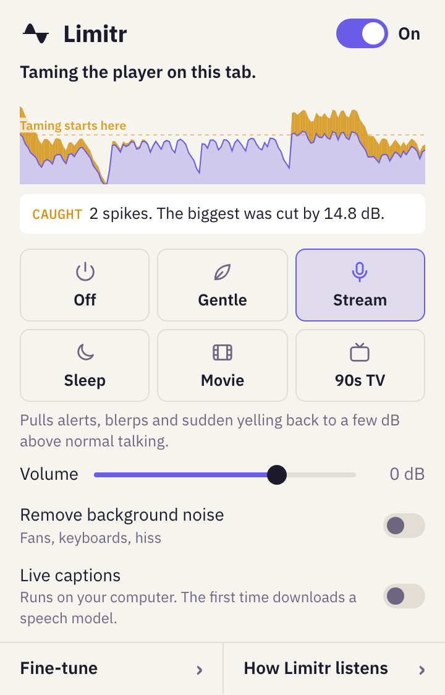
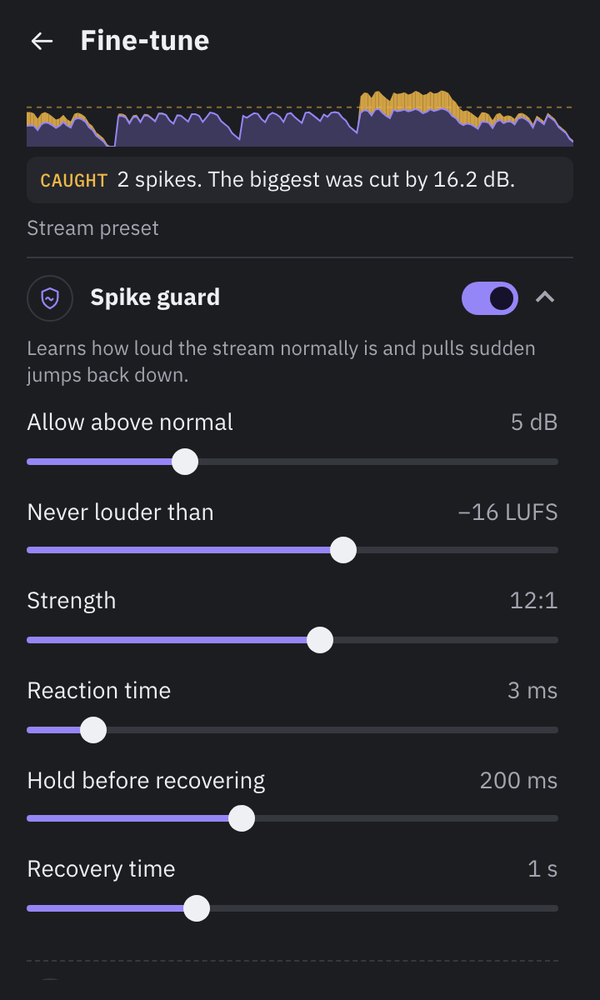

<p align="center">
  
</p>

<p align="center">
  A browser extension for Chrome and Firefox that tames sudden loud spikes (alerts, blerps,
  yelling streamers, explosions) so you can watch at night, or fall asleep to a stream, without
  being jolted awake. Normal audio passes through untouched.
</p>

<table align="center">
  <tr>
    <td valign="top"></td>
    <td valign="top"></td>
    <td valign="top"></td>
  </tr>
</table>

## What it does

Limitr learns how loud the stream normally is and pulls anything that jumps well above that back
down within milliseconds, before the loud part reaches your ears. A yelling fit stays tamed for as
long as it lasts. A stream that is louder than the preset's comfortable level is turned down to it,
smoothly. Quieter sound, like a streamer who starts whispering, is left alone. Set the volume once,
where quiet talking is easy to hear, and leave it running.

The popup shows a live loudness trace: purple is what you hear, gold is what Limitr shaved off, and
the dashed line is where taming starts. It counts the spikes it caught and how hard it cut the
biggest one. The toolbar icon tells you the state at a glance: gray when Limitr is off, purple when
it's on, gold while it's working on the tab, and red when sound is playing unprotected and Limitr
needs you (the popup says what to do).

| Preset | What it does |
|--------|--------------|
| Off | Audio plays exactly as the site sends it |
| Gentle | Steps in only when something is far louder than the talking around it; only very loud streams are turned down |
| Stream | Pulls alerts, blerps and sudden yelling back to a few dB above normal talking; loud streams come down to one comfortable level |
| Sleep | Quiet and even: spikes barely rise above normal, every stream sits at one low level (quiet ones are lifted a little), softer highs |
| Movie | Tames explosions and music stings, leaves dialog alone |
| 90s TV | Narrow, warm broadcast sound with a little tape hiss (pair it with the CRT look) |

You can save your own presets on the Fine-tune screen.

**Extras**

- **Live captions, on your computer:** Moonshine for live English, Whisper for Turkish and 14 other
  languages, or detect the language automatically. Chrome and Edge can translate them with their
  on-device translator. On Chrome and Edge you can switch on a larger, more accurate model that
  runs on the graphics card (410 MB, off by default).
- **Remove background noise:** RNNoise, running locally
- **Fine-tune:** spike guard, peak limiter, tone (low/high cut and a 5-band EQ), a classic
  compressor, tape hiss, a mono fix and a CRT video look

## Results

Measured by `tests/run-engine-tests.js`, which renders a synthetic stream through the real engine
in Chromium and Firefox (both give the same numbers): talking with a sudden yell, an alert chime
and a clap, and a 20 s yelling fit. Spike figures are loudness above normal talking, for a stream
at −24 LUFS. They stay within a few tenths of a dB of these at every source level from −36 LUFS
(a quiet podcast) to −10 LUFS (a loud Twitch stream).

| Preset | Yell | Alert | Clap | 20 s yelling fit, 8 s in | Output peak |
|--------|-----:|------:|-----:|-------------------------:|------------:|
| Off | +13.5 dB | +16.7 dB | +8.2 dB | +10.7 dB | as sent |
| Gentle | +11.0 dB | +10.7 dB | +6.8 dB | +9.6 dB | −1.5 dBFS |
| Stream | +6.3 dB | +5.4 dB | +3.0 dB | +5.0 dB | −7.0 dBFS |
| Movie | +9.3 dB | +8.6 dB | +5.3 dB | +7.9 dB | −3.7 dBFS |
| 90s TV | +6.8 dB | +7.5 dB | +3.5 dB | | −10.9 dBFS |
| Sleep | +4.6 dB | +3.3 dB | +1.5 dB | +2.8 dB | −11.5 dBFS |

Where normal talking ends up, by how loud the stream is:

| Preset | Comfortable level | Quiet stream (−30 LUFS) | −24 LUFS | Loud stream (−10 LUFS) |
|--------|------------------:|------------------------:|---------:|-----------------------:|
| Gentle | −14 LUFS | unchanged | unchanged | −13.9 LUFS |
| Stream | −20 LUFS | unchanged | unchanged | −19.8 LUFS |
| Movie | −18 LUFS | unchanged | unchanged | −17.8 LUFS |
| Sleep | −28 LUFS | −28.1 LUFS (lifted) | −28.0 LUFS | −28.0 LUFS |

90s TV is −20 LUFS too, but its own tone and compressor shape the sound on purpose. While the
stream plays normally, the guard stays idle: it doesn't touch plain talking at any level.

The guard lets go 0.4 to 2.6 seconds after a spike ends, depending on the preset. Turning the
Limitr volume up or down changes how loud everything is and nothing else: the tests check that
the slider moves normal talking by exactly the same number of dB, and that spikes are tamed the
same at −12 dB (and at +6 dB in Stream and Sleep). Near full scale the limiter only ever makes
spikes smaller. With Limitr turned off, the audio is bit-for-bit what the site sent. The Off
preset adds only a constant 25 ms delay.

## How it works

```
source → [mono fix] → [noise removal] → [low cut → EQ → high cut] → [compressor]
       → spike guard + comfortable level (20 ms lookahead) → [tape hiss] → volume
       → brickwall limiter (5 ms lookahead) → output
```

Stages in brackets are optional. Gains (the volume and the compressor's makeup) come after the
guard, so it always judges the stream itself: spikes are tamed the same at every volume, and the
slider only changes how loud it all is. The tape hiss joins after the guard so it's never mistaken
for the stream. The limiter's ceiling moves with the volume and never goes past 0 dBFS.

**Spike guard** (an AudioWorklet, `lib/dsp-worklet.js`):

1. Measures loudness the way broadcast meters do (K-weighted), three ways at once: a fast reading
   for hits, a 50 ms one for the start of a sustained sound, and a 400 ms one for what the ear
   hears. Each is compared after taking off the crest it normally has on this stream, so all
   three speak the same LUFS as the threshold.
2. Takes "normal" to be the median loudness of the last 20 seconds of non-silent audio. A jump of
   more than 3 dB only becomes the new normal after it has lasted the preset's memory (15 s for
   Gentle, 30 s for Movie, 60 s for Stream, 5 minutes for Sleep), so a yelling fit stays a spike.
   Coming back to the stream's familiar level is always allowed, so a quiet BRB screen doesn't
   leave the voice ducked.
3. Anything louder than normal plus the preset's headroom (2.5 to 9 dB) is pulled back down. The
   20 ms lookahead lets the gain drop before the jump reaches the output.
4. The comfortable level turns the stream's normal loudness down to the preset's level within
   about a second when it's louder, and leaves quieter streams alone (Sleep lifts them by up to
   6 dB). A new video starts fresh, and the site's own volume slider acts like a plain gain.
5. A brickwall limiter at the end, also with lookahead, makes sure no sample goes over the ceiling.

**Compressor without the hidden boost:** Web Audio's `DynamicsCompressorNode` applies automatic
makeup gain that can't be turned off: +15.3 dB at −30 dB / 12:1. Limitr cancels it exactly, to
within 0.001 dB in both Chromium and Firefox, so the compressor never makes quiet audio louder.

**How Limitr listens:**

- **Inside the page** (default, every browser): each `<video>`/`<audio>` element, including players
  inside iframes, goes through the engine, and fullscreen keeps working. Limitr only takes over a
  player when the result is sure to be audible. Cross-origin media without CORS, DRM video and
  WebRTC calls are left alone, and the popup tells you when that happens.
- **Whole tab** (Chrome and Chromium): captures the tab's entire output, including protected video
  and Web Audio games. Chrome only allows this after you open the extension on the tab, so capture
  starts when you open the popup there. Fullscreen video stays inside the window while a tab is
  captured, and each captured tab gets its own volume.

## What's new in 2.1

An independent audit of the maths and a review of the chain design, both measured on streams from
−36 to −10 LUFS, found the 2.0 guard working against itself on louder streams. YouTube plays
around −14 LUFS, and there 2.0 turned normal talking down 5–7 dB and rode it constantly. 2.1
replaces the guard's fixed ceiling with a comfortable level per preset, and holds a yelling fit
down instead of accepting it after 6–8 s. On louder streams the guard now stays idle on normal
talking. Tape hiss and compressor makeup no longer fight the guard, and the spike counter and
"biggest cut" now report what you heard.

## What's new in 2.0

2.0 rebuilds Limitr around one job: tame sudden loud spikes without touching everything else. In
1.x, the presets were mostly making things worse.

**What was fixed**

- **Quiet audio got louder.** Every 1.x compressor preset carried the browser's hidden makeup gain,
  so normal talking was boosted while the meter showed heavy reduction. 2.0 cancels that boost.
- **Auto-gain fought the compressor.** It boosted straight back whatever the compressor took off,
  so the 1.x Anti-Scream preset only reduced a scream by about 0.5 dB. 2.0 has no auto-gain;
  the spike guard decides from the stream's own normal level instead.
- **Makeup gain clipped loud sources.** 2.0 has no makeup boost, and a lookahead limiter holds
  the ceiling.
- **Exclusive mode never started on its own.** Chrome only lets an extension capture a tab after
  you open it there. Whole tab now starts when you open the popup, and Inside the page covers
  everything else.
- **Some players went silent.** Routing cross-origin or DRM media through Web Audio mutes it. 2.0
  leaves those players alone, and the icon turns red so you know.
- **Firefox works.** 2.0 runs on Firefox 140 and newer and is tested in real Firefox.
- **12 overlapping presets became 6.** Each one is checked against measured targets on every test
  run (the Results table above).

**New design**

- A new mark: one period of a sine wave on a line that runs past it, a signal held in bounds.
- Night and day themes that follow your system: cool graphite with purple at night, warm paper by
  day. Type is IBM Plex Sans.
- A live loudness trace and a caught-spike counter on the main screen. Fine-tune, captions and
  "How Limitr listens" each get a screen of their own.
- Toolbar icon states: gray, purple, gold and red.

**Faster.** Medians from the benchmarks in `tests/bench/`, before → after this release's
performance pass:

| What | Before | After |
|------|-------:|------:|
| Service worker CPU per page load (page with 20 iframes, nothing playing) | 196 ms | 13 ms |
| Toolbar icon calls per ordinary page load | 22 | 0 |
| Popup: live meters on screen after opening | 111 ms | 58 ms |
| Popup: main-thread time while open (main screen) | 23 ms/s | 13.5 ms/s |
| Whisper, one 8 s sentence (Chrome, 4 threads) | 4.9 s | 2.3 s |
| Moonshine, one 8 s sentence (Chrome) | 1.07 s | 0.66 s |
| First caption with "Detect automatically" (captions test) | 24 s | 12–14 s |

Firefox can't share memory between threads in extension pages, so Whisper stays single-threaded
there, at about 5 s per sentence.

## Installation

### From a release

Download the zip for your browser from [Releases](https://github.com/ozankaraali/limitr/releases).

- **Chrome, Edge and other Chromium browsers:** unzip `limitr-<version>-chrome.zip`, open
  `chrome://extensions/`, turn on Developer mode, click **Load unpacked** and pick the unzipped folder.
- **Firefox 140 or newer:** open `about:debugging#/runtime/this-firefox`, click **Load Temporary
  Add-on** and pick `limitr-<version>-firefox.zip`. Temporary add-ons are removed when Firefox
  restarts; permanent installs need the add-on to be signed by Mozilla.

### From source

- **Chrome:** load this folder with **Load unpacked**, or run `npm run build:chrome` and load
  `dist/chrome`.
- **Firefox:** run `npm run build:firefox` and load `dist/firefox/manifest.json` as a temporary
  add-on.

## Development

```
npm install
npx playwright install chromium firefox
npm test                 # engine checks in Chromium + Firefox, and Chromium end-to-end
npm run test:firefox     # end-to-end in your installed Firefox
npm run test:captions    # live captions with the real speech models (macOS, uses `say`)
npm run lint:firefox
npm run build:chrome     # dist/chrome
npm run build:firefox    # dist/firefox
npm run release          # both, zipped into dist/ for a release
npm run icons            # toolbar and app icons from icons/mark.svg
npm run store-art        # README screenshots and store artwork in docs/store/
```

- Test browsers run headless, silent (no audio device is opened) and off the GPU.
- `node tests/run-asset-tests.js` checks the icons and artwork, and checks that each package holds
  everything the add-on loads and nothing else.
- **Debug harness:** right-click the toolbar icon and choose Debug Harness to play any recording
  through the engine, watch the trace and compare all presets offline.
- **Benchmarks** in `tests/bench/` measure page-load cost, popup speed and caption latency. Pass
  `--ext=DIR` more than once to compare copies of the extension.

## Privacy

Limitr doesn't collect or send anything. Audio is processed in your browser. Captions run on your
computer; the speech models are downloaded once from Hugging Face. See the
[privacy policy](docs/PRIVACY.md).

## License

[MIT](LICENSE). Ozan Karaali
