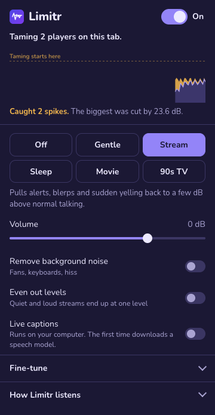
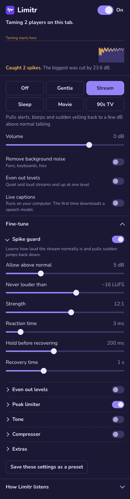

<p align="center">
  
</p>

<h1 align="center">Limitr</h1>

<p align="center">
  A browser extension that tames sudden loud spikes (alerts, blerps, yelling streamers, explosions)<br>
  so you can watch at night, or fall asleep to a stream, without being jolted awake.
</p>

<table align="center">
  <tr>
    <td valign="top"></td>
    <td valign="top"></td>
  </tr>
</table>

## What it does

Limitr learns how loud the stream normally is, from the last ~20 seconds of talking, and pulls anything
that jumps more than a few dB above that back down within milliseconds. A short lookahead lets it act
before the loud part reaches your ears. Normal audio passes through untouched, so quality stays intact.

The popup shows a live loudness trace. Purple is what you hear, amber is what Limitr shaved off, and the
dashed line is where taming starts. It also counts the spikes it has caught.

### Presets

| Preset | What it does |
|--------|--------------|
| Off | Audio plays exactly as the site sends it |
| Gentle | Steps in only when something is far louder than the talking around it |
| Stream | Pulls alerts, blerps and sudden yelling back to a few dB above normal talking |
| Sleep | Quiet and even: spikes barely rise above normal, every stream sits at one level, softer highs |
| Movie | Tames explosions and music stings, leaves dialog alone |
| 90s TV | Narrow, warm broadcast sound with a little tape hiss (pair it with the CRT look) |

You can save your own presets from the Fine-tune drawer.

### Extras

- **Remove background noise:** RNNoise, running locally
- **Even out levels:** slowly brings every stream to the same normal loudness
- **Live captions, running locally:** Moonshine for live English, Whisper for Turkish and 15 other
  languages (or detect the language automatically). Translated captions use Chrome and Edge's
  on-device translator; Firefox, and any browser without one, can translate into English only
- **Fine-tune:** spike guard, peak limiter, tone (low/high cut and a 5-band EQ), a classic compressor, tape hiss, a mono fix and a CRT video look

## Installation

### Chrome, Edge and other Chromium browsers

1. Open `chrome://extensions/`
2. Turn on Developer mode
3. Click **Load unpacked** and select this folder

### Firefox (140 or newer)

1. Run `node build-firefox.js`
2. Open `about:debugging#/runtime/this-firefox`
3. Click **Load Temporary Add-on** and select `dist/firefox/manifest.json`

Permanent installs need the add-on to be signed by Mozilla.

## How Limitr listens

**Inside the page** (default, every browser): Limitr routes each `<video>`/`<audio>` element, including
players inside iframes, through its audio engine. It works in fullscreen. It only takes over a player
when the result is guaranteed to be audible: cross-origin media without CORS, DRM-protected video and
WebRTC calls are left alone, and the popup tells you when that happens.

**Whole tab** (Chrome and Chromium only): Limitr captures the tab's entire audio output, including
protected video and Web Audio games. Chrome only lets an extension capture a tab after you open it there,
so capture starts when you open the Limitr popup on that tab. Fullscreen video stays inside the window
while a tab is captured. The popup also lets you set a volume for each captured tab.

## Signal chain

```
source → [mono fix] → [noise removal] → [low cut → EQ → high cut] → [compressor] → volume
       → spike guard (adaptive, 10 ms lookahead) → brickwall limiter (5 ms lookahead) → output
```

Every stage in brackets is optional. Volume comes before the guard, so "never louder than" really is the
loudest thing you will hear. The spike guard and limiter add a constant 15 ms of latency.

Web Audio's `DynamicsCompressorNode` silently applies automatic makeup gain that can't be turned off
(+15 dB at −30 dB / 12:1). Limitr cancels it exactly, so the compressor never makes quiet audio louder.

## Development

```
npm install
npx playwright install chromium firefox
npm test                 # engine checks in Chromium + Firefox, and Chromium end-to-end
npm run test:firefox     # end-to-end in your installed Firefox
npm run build:firefox
npm run lint:firefox
```

- `tests/run-engine-tests.js` renders a synthetic stream (talking, a sudden yell, an alert chime, a clap)
  through the real engine and checks that normal audio is untouched and the spikes are tamed.
- **Debug harness:** right-click the toolbar icon and choose Debug Harness to play any recording
  through the engine, watch the trace and compare all presets offline.

## Privacy

Limitr doesn't collect or send anything. All audio processing happens in your browser. See the
[privacy policy](docs/PRIVACY.md).

## License

[MIT](LICENSE). Ozan Karaali
